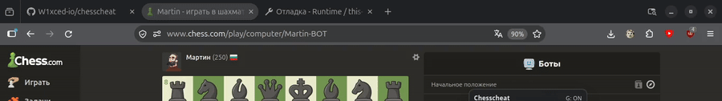

<h1>Chess Cheat</h1>

Faster and more accurate than the original: quicker move detection, better engine analysis, a richer GUI, and bundled Stockfish.

Chess cheat utilizes the Stockfish engine and the power of your computer to show you the best move to make in any chess.com game. It guarantees you wins in at least 90% of games you play and can greatly help you improve your chess skills.

<i>Note: this project was developed for learning purposes, I do not condone or encourage cheating in games and this project should help you get better at chess. Non fair play might result in your chess.com account being suspended if you do not use wisely. </i>
 

<h2>What's improved vs the original</h2>
<ul>
  <li><b>Performance & analysis:</b> fast move detection (MutationObserver + debounce), one search at a time with <code>stop</code> before new positions, stale-result filtering, and engine worker cleanup on stop.</li>
  <li><b>Accurate positions:</b> reads the exact FEN from chess.com's board API when available (castling rights, en passant, side to move) with a DOM fallback that infers castling/en passant and tracks the mover.</li>
  <li><b>Bundled engine:</b> ships Stockfish 19 lite (single-threaded WASM) in <code>engine/</code>, loaded via a bridge/blob worker with fallback to chess.com's engine - no dependency on site engine path/hash changes.</li>
  <li><b>Correct side to move:</b> detects which color you play to avoid showing the opponent's best move as yours.</li>
  <li><b>Richer GUI/status:</b> draggable, resizable glassy panel with scalable controls; shows search depth, evaluation (cp/mate), and best move in SAN.</li>
  <li><b>Flash & stealth controls:</b> configurable flash key (default <code>`</code>) to briefly reveal the move, <b>Hide until key</b> mode, and an option to allow flashing while the GUI is hidden with <code>G</code>.</li>
  <li><b>Persistence & cleanup:</b> depth/flash/hide settings saved in <code>localStorage</code>; unused legacy files removed and manifest/architecture cleaned up (main-world script + bridge for bundled engine access).</li>
</ul>

<h1>Usage</h1>
<ul>
  <li>A draggable, resizable GUI appears on chess.com pages.</li>
  <li>Click <b>Start</b> to run analysis, <b>Stop</b> to stop.</li>
  <li>Press <b>G</b> to toggle the GUI and hints/highlights on/off. While typing in inputs, <b>G</b> won't toggle.</li>
  <li>Adjust <b>Depth</b> in the panel (saved automatically).</li>
  <li><b>Flash:</b> click <b>Flash</b> to set a key, press it to show the move briefly (~700 ms). Enable <b>Hide until key</b> to keep hints hidden until flashed; optionally enable flashing while the GUI is hidden with <code>G</code>.</li>
  <li>Drag the panel by its header and resize from the bottom-right corner.</li>
</ul>

<h1>How to install (Firefox):</h1>
1. Open Firefox and go to <code>about:debugging#/runtime/this-firefox</code>. 
2. Click <b>Load Temporary Add-on...</b> 
3. Select <code>manifest.json</code> from this folder.

<h1>How to install (Chrome):</h1>
Open <code>chrome://extensions</code>, enable Developer mode, click <b>Load unpacked</b>, and select this folder.

<h1>How to install (Microsoft Edge):</h1>
Open <code>edge://extensions</code>, enable Developer mode, click <b>Load unpacked</b>, and select this folder.

<h1>How to install (Safari, macOS):</h1>
1. Requires macOS with Safari 15.4+ and Xcode Command Line Tools. 
2. Convert the extension: <code>xcrun safari-web-extension-converter /path/to/this/folder</code> 
3. Open the generated Xcode project, build and run. 
4. In Safari: Settings → Extensions, enable the extension and allow it for chess.com.