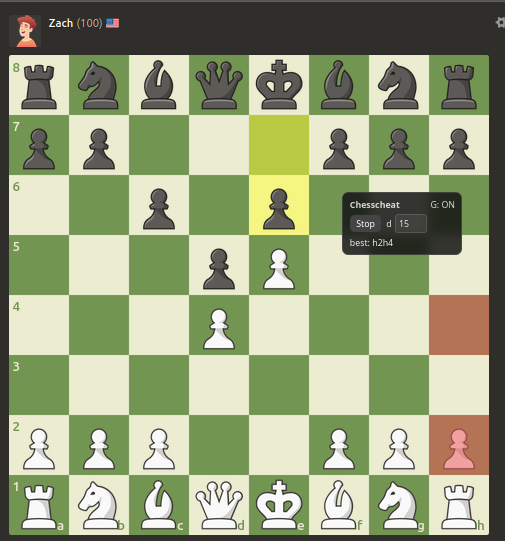

<h1>Chess Cheat</h1>

Much faster than the original: quicker move detection (MutationObserver + debounce), optimized engine search with request cancellation/stale-result filtering, and a minimal draggable GUI.

Chess cheat utilizes the stockfish engine and the power of your computer to show you the best move to make in any chess.com game. It guarantees you wins in atleast 90% of games you play and can greatly help you improve your chess skills.

<i>Note: this project was developed for learning purposes, I do not condone or encourage cheating in games and this project should help you get better at chess. Non fair play might result in your chess.com account being suspended if you do not use wisely. </i>
 

[Watch preview video](preview.mp4)

<h1>Usage</h1>
- A minimal draggable GUI appears on chess.com pages.
- Click <b>Start</b> to run analysis, <b>Stop</b> to stop.
- Press <b>G</b> to toggle GUI and hints/highlights on/off (visual only, like unhook). Press <b>G</b> again to show them. While typing in inputs, <b>G</b> won't toggle.
- Drag the panel by its header. Adjust depth in the GUI.

<h1>How to install (Firefox):</h1>
1. Open Firefox and go to <code>about:debugging#/runtime/this-firefox</code>.
2. Click <b>Load Temporary Add-on...</b>
3. Select <code>manifest.json</code> from this folder.

<h1>How to install (Chrome):</h1>
Open <code>chrome://extensions</code>, enable Developer mode, click <b>Load unpacked</b>, and select this folder.

<h1>How to install (Microsoft Edge):</h1>
Open <code>edge://extensions</code>, enable Developer mode, click <b>Load unpacked</b>, and select this folder.

<h1>How to install (Safari, macOS):</h1>
1. Requires macOS with Safari 15.4+ and Xcode Command Line Tools.
2. Convert the extension: <code>xcrun safari-web-extension-converter /path/to/this/folder</code>
3. Open the generated Xcode project, build and run.
4. In Safari: Settings → Extensions, enable the extension and allow it for chess.com.